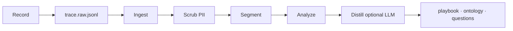
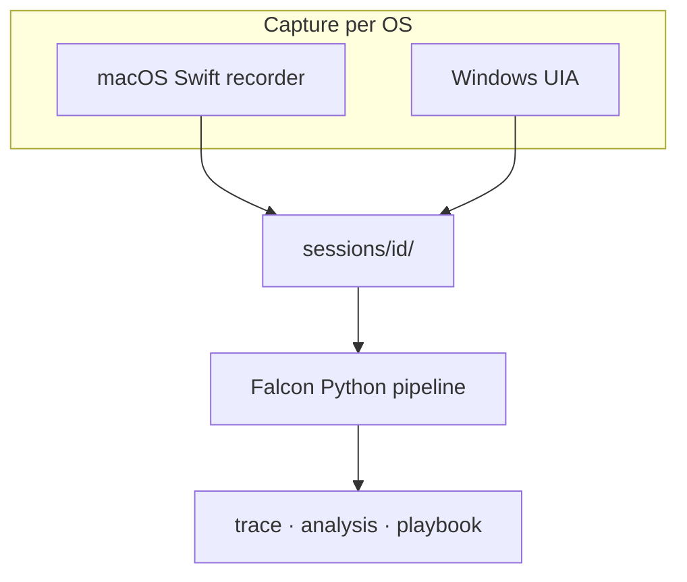

<div align="center">
  <picture>
    
  </picture>
  <p>
    <strong>Turn voluntary UI shadowing into evidence-backed playbooks</strong><br />
    Local capture, PII scrubbing, and ontology proposals — without sending screenshots to the cloud
  </p>
  <p>
    
    
    
    
  </p>
</div>

Teams learn how work really gets done by watching screens, clicks, and app switches — but that knowledge rarely becomes structured documentation. Falcon records a **consent-based session** on the user’s machine, builds a readable **trace**, and produces a **playbook**, **ontology proposals**, and **competency questions** with citations back to events in the trace.

Capture is **platform-native** (Swift on macOS, UI Automation on Windows). Analysis is one shared **Python pipeline**: normalize recorder output, scrub sensitive text, segment tasks, describe steps, and optionally call an LLM only for ontology and questions. Screenshots stay on disk; **scrubbed event text** is what may be sent to the model when you run `distill`.

Falcon does not replace your systems of record. It assumes you already have someone willing to be shadowed and a safe place to store session folders locally. It focuses on **trace quality**, **privacy invariants**, and **reviewable outputs** you can edit before wider use.

---

## Quick start

**End users (no Python tools):** download the latest **`Falcon-macos-*.zip`** or **`Falcon-win64.zip`** from [Releases](https://github.com/trybacked/falcon/releases), unzip, run **Install** (macOS: `Install.command`, Windows: `Install.ps1`), open a new terminal:

```bash
falcon record --name demo
# work as usual, then Ctrl+C to stop

falcon analyze --session demo
export AI_GATEWAY_API_KEY=...   # only for distill
falcon distill --session demo
falcon report --session demo
```

On macOS, grant **Accessibility** (and often **Input Monitoring**) to `falcon-recorder` when prompted. See `README.txt` inside the release bundle.

**Contributors** (from source):

```bash
git clone https://github.com/trybacked/falcon.git
cd falcon && uv sync --group dev
uv run falcon --help
```

Build a release bundle locally:

```bash
bash scripts/build-release-macos.sh      # → dist/Falcon-macos-<arch>.zip
# Windows: ./scripts/build-release-windows.ps1
```

---

## Session model

| Artifact | Meaning |
| -------- | ------- |
| **Session** | One shadowing run under `sessions/<id>/`, with `manifest.json` and consent |
| **Trace (raw)** | JSONL from the recorder (`kind` on macOS Swift, or native events on Windows) |
| **Trace (clean)** | Scrubbed `CaptureEvent` rows in `trace.jsonl` |
| **Segment** | Groups of events separated by idle time or app change |
| **Step** | One user-visible action with a description and evidence event ids |
| **Playbook** | Human-readable steps (deterministic from the trace) |
| **Ontology / CQs** | YAML proposals from the LLM, tied to step ids |

Each step cites **event ids** (`E-*`), not timestamps alone, so outputs stay auditable against the trace.



Recording produces raw JSONL. Ingest normalizes recorder formats. Scrubbing removes or tokenizes PII. Analyze builds steps and segments. Distill adds ontology and competency questions when an API key is configured.

---

## Operating model

| Step | Question | What happens |
| ---- | ---------- | ------------ |
| **Record** | What did the user do? | macOS: Swift `falcon-recorder` · Windows: UIA capture → `sessions/<id>/trace.raw.jsonl` |
| **Check** | Is the bundle valid? | `falcon check` — manifest, consent, non-empty trace |
| **Ingest** | Is the trace in one shape? | Optional normalize in place on `trace.raw.jsonl` |
| **Analyze** | What are the steps? | Scrub → `trace.jsonl`, `segments.json`, `analysis.json` |
| **Distill** | What ontology fits? | LLM → `playbook.md`, YAML files (playbook text is also built without LLM) |
| **Report** | Show the playbook | Prints `playbook.md` |



---

## Command reference

Global: `falcon --version` · `falcon --config path/to/config.toml` · env `FW_*` (see `config.toml.example`).

| Command | Phase | Result |
| ------- | ----- | ------ |
| `falcon record --name ID` | Capture | New session folder + recording (Ctrl+C to stop) |
| `falcon record --legacy-python` | Capture | Deprecated PyObjC path on macOS only |
| `falcon check --session ID` | Validate | Manifest + trace checks, no writes |
| `falcon ingest --session ID` | Normalize | Recorder JSONL → unified events in `trace.raw.jsonl` |
| `falcon analyze --session ID` | Understand | Scrubbed trace, segments, `analysis.json` |
| `falcon distill --session ID` | Enrich | Playbook + ontology + competency questions (needs API key) |
| `falcon report --session ID` | Read | Playbook to stdout |

If `--session` is omitted, commands use the latest session under `sessions_root` (from config).

---

## Data residency

| Data | Leaves the machine |
| ---- | ------------------ |
| Screenshots / frames | **No** — stay under the session folder unless you copy them |
| Raw + scrubbed trace | **No** — local JSONL unless you upload them |
| Playbook / YAML outputs | **No** — written next to the session |
| LLM request (`distill`) | **Yes** — scrubbed step descriptions and metadata only; no frame payloads in prompts |

Set `AI_GATEWAY_API_KEY` (or `llm.api_key_env` in config) only when you choose to run `distill`. Recording and `analyze` do not require a network call.

---

## Security note

Falcon uses OS-level **accessibility and input** APIs to record UI activity (similar to assistive or automation tools). Unsigned release binaries may trigger antivirus **false positives**, especially PyInstaller bundles. Prefer [official Releases](https://github.com/trybacked/falcon/releases), verify checksums when published, and plan **code signing + notarization** (macOS) / **Authenticode** (Windows) for production rollouts.

---

## Development

```bash
uv sync --group dev
make ci          # ruff + mypy + pytest
uv run pytest -q
```

macOS recorder (from repo root):

```bash
cd packages/platform-macos && swift build -c release
```

Push a version tag to build release zips in CI:

```bash
git tag v0.1.0 && git push origin v0.1.0
```

```
falcon/
├── packages/platform-macos/   # Swift falcon-recorder (macOS capture)
├── src/falcon/                # ingest, pipeline, analyze, distill, CLI
├── scripts/                   # release build + install helpers
├── tests/
└── config.toml.example
```

| Component | Responsibility |
| --------- | ---------------- |
| `falcon-recorder` | macOS JSONL capture (clicks, keys, window changes) |
| `falcon.capture.windows` | Windows UIA polling backend |
| `falcon.ingest` | Recorder formats → `CaptureEvent` |
| `falcon.pipeline` | Scrub, segment, analyze orchestration |
| `falcon.distill` | Playbook + LLM ontology/CQ |
| `falcon` CLI | User-facing commands and bundled installs |

