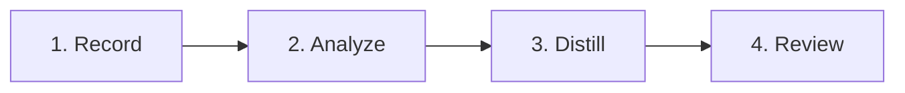

<div align="center">
  <picture>
    
  </picture>
  <p>
    <strong>Local UI shadowing that produces evidence-backed playbooks</strong><br />
    Record a work session on your own machine. Get a step-by-step playbook, ontology proposals, and competency questions, each one linked to the events that justify it.
  </p>
  <p>
    
    
    
    
  </p>
</div>

## What Falcon does

Most organizations know how work gets done only through the people who do it. Falcon makes that knowledge explicit. A person agrees to be shadowed, starts a recording, and works as usual. When the session ends, Falcon turns the recorded activity into documentation that can be reviewed, edited, and shared.

Falcon produces three outputs for every session:

| Output | File | Description |
| ------ | ---- | ----------- |
| **Playbook** | `playbook.md` | A readable list of the steps the person performed |
| **Ontology proposals** | `ontology_proposals.yaml` | Business objects, properties, and relationships observed during the session |
| **Competency questions** | `competency_questions.yaml` | Questions the resulting ontology should be able to answer |

Every step cites the event identifiers it was derived from, so each statement can be traced back to the original recording.

Falcon is built around three principles:

1. **Consent first.** Recording starts only when the user launches it and stops when the user presses `Ctrl+C`. Every session carries an explicit consent flag in its manifest.
2. **Local by default.** Recording and analysis run entirely on the user's machine. Only the final `distill` step contacts an LLM, and it sends scrubbed text, never screenshots.
3. **Reviewable results.** Outputs are plain Markdown and YAML files. Nothing is published automatically.

---

## How it works



| Phase | What happens | Where it runs |
| ----- | ------------ | ------------- |
| **1. Record** | A native recorder captures clicks, keystrokes, and window changes into a raw trace | Your machine |
| **2. Analyze** | Falcon removes personal data, groups events into tasks, and describes each step | Your machine |
| **3. Distill** | An LLM proposes an ontology and competency questions based on the scrubbed steps | Your machine, with one outbound API call |
| **4. Review** | You read the playbook and edit the YAML proposals before sharing them | Your machine |

Capture is platform specific. On macOS, Falcon ships a Swift recorder (`falcon-recorder`) that uses the Accessibility APIs. On Windows, it uses UI Automation. Everything after capture is a single Python pipeline shared by both platforms.

---

## Installation

### End users

No Python, `uv`, or `pip` is required.

1. Download the latest archive from [Releases](https://github.com/trybacked/falcon/releases):
   `Falcon-macos-<arch>.zip` for macOS or `Falcon-win64.zip` for Windows.
2. Unzip the archive.
3. Run the installer:
   on macOS, double-click `Install.command`;
   on Windows, right-click `Install.ps1` and choose *Run with PowerShell*.
4. Open a new terminal and run `falcon --version` to confirm the installation.

On macOS, the system will ask you to grant **Accessibility** and, in most cases, **Input Monitoring** permissions to `falcon-recorder`. Both are required to capture user activity. You can review them later under *System Settings > Privacy & Security*.

### From source

Requirements: Python 3.12 or later and [uv](https://docs.astral.sh/uv/). On macOS, Xcode command line tools are needed to build the recorder.

```bash
git clone https://github.com/trybacked/falcon.git
cd falcon
uv sync --group dev
cd packages/platform-macos && swift build -c release && cd ../..   # macOS only
uv run falcon --help
```

---

## Usage

A complete session takes four commands.

```bash
# 1. Start recording. Work as usual, then press Ctrl+C to stop.
falcon record --name demo

# 2. Scrub personal data and build the step-by-step analysis.
falcon analyze --session demo

# 3. Generate the playbook and the ontology proposals (requires an API key).
export AI_GATEWAY_API_KEY="your-key"
falcon distill --session demo

# 4. Print the playbook.
falcon report --session demo
```

All files are written to `sessions/demo/`. If you omit `--session`, Falcon uses the most recent session.

### Commands

| Command | Purpose | Writes |
| ------- | ------- | ------ |
| `falcon record --name <id>` | Start a new recording session | `manifest.json`, `trace.raw.jsonl` |
| `falcon check --session <id>` | Validate a session without modifying it | Nothing |
| `falcon ingest --session <id>` | Normalize the raw trace into a single event format | `trace.raw.jsonl` (in place) |
| `falcon analyze --session <id>` | Scrub personal data, segment tasks, describe steps | `trace.jsonl`, `segments.json`, `analysis.json` |
| `falcon distill --session <id>` | Produce the playbook and ontology proposals via LLM | `playbook.md`, `ontology_proposals.yaml`, `competency_questions.yaml` |
| `falcon report --session <id>` | Print the playbook to the terminal | Nothing |

Global options: `--version` prints the version, `--config <path>` selects a configuration file.

`ingest` is optional. `analyze` normalizes the trace automatically; run `ingest` only when you want to inspect the normalized trace before analysis.

---

## Session folder

Each session lives in its own folder under `sessions/`.

| File | Created by | Contents |
| ---- | ---------- | -------- |
| `manifest.json` | `record` | Session id, consent flag, Falcon version, platform |
| `trace.raw.jsonl` | `record` | Raw events from the recorder, one JSON object per line |
| `trace.jsonl` | `analyze` | The same events after personal data has been removed |
| `segments.json` | `analyze` | Groups of events separated by idle time or application change |
| `analysis.json` | `analyze` | One entry per step, with description and supporting event ids |
| `playbook.md` | `distill` | The human-readable playbook |
| `ontology_proposals.yaml` | `distill` | Proposed objects, properties, and relationships |
| `competency_questions.yaml` | `distill` | Questions the ontology should answer |

---

## Configuration

Falcon reads `config.toml` from the current directory, from the path given with `--config`, or from the `FW_CONFIG` environment variable. All settings have defaults, so the file is optional. A full example is provided in [`config.toml.example`](./config.toml.example).

| Section | Key | Default | Description |
| ------- | --- | ------- | ----------- |
| `capture` | `idle_gap_s` | `45.0` | Seconds of inactivity that start a new segment |
| `capture` | `frame_interval_s` | `3.0` | Minimum interval between captured frames |
| `llm` | `base_url` | Vercel AI Gateway | OpenAI-compatible endpoint used by `distill` |
| `llm` | `model` | `openai/gpt-4o-mini` | Model used by `distill` |
| `llm` | `api_key_env` | `AI_GATEWAY_API_KEY` | Environment variable that holds the API key |
| `paths` | `sessions_root` | `sessions` | Folder where sessions are stored |
| `output` | `language` | `it` | Language of the generated playbook and proposals |

---

## Privacy and data residency

Falcon is designed so that sensitive material never leaves the machine unless you decide otherwise.

| Data | Sent to the LLM | Notes |
| ---- | --------------- | ----- |
| Screenshots and frames | No | Stored only inside the session folder |
| Raw trace (`trace.raw.jsonl`) | No | May contain personal data; keep it local |
| Scrubbed trace and analysis | No | Used only as input for `distill` |
| Step descriptions and metadata | Yes, during `distill` | Personal data is removed before sending |
| Playbook and YAML outputs | No | Written next to the session |

`record`, `check`, `ingest`, and `analyze` work fully offline. Only `distill` requires network access and an API key.

---

## Security considerations

Falcon relies on operating system accessibility and input APIs to observe user activity, the same APIs used by assistive technologies and automation tools. Because of this, and because release bundles are built with PyInstaller, antivirus software may report false positives on unsigned binaries.

Recommendations:

- Install only from the official [Releases](https://github.com/trybacked/falcon/releases) page.
- Verify checksums when they are published alongside a release.
- For organization-wide deployments, sign and notarize the macOS bundle and sign the Windows bundle with Authenticode.

---

## Development

```bash
uv sync --group dev
make ci              # lint (ruff), type check (mypy), tests (pytest)
uv run pytest -q
```

Build a release bundle locally:

```bash
bash scripts/build-release-macos.sh        # produces dist/Falcon-macos-<arch>.zip
./scripts/build-release-windows.ps1        # produces dist/Falcon-win64.zip
```

Pushing a tag that starts with `v` triggers the release workflow, which builds both bundles and attaches them to a GitHub Release:

```bash
git tag v0.1.0
git push origin v0.1.0
```

### Project structure

```
falcon/
  packages/platform-macos/   Swift recorder for macOS
  src/falcon/                Python pipeline and CLI
  scripts/                   Release build and installer scripts
  tests/                     Test suite
  config.toml.example        Example configuration
  plan.md                    Design notes
```

| Module | Responsibility |
| ------ | -------------- |
| `falcon-recorder` | Captures clicks, keystrokes, and window changes on macOS |
| `falcon.capture.windows` | Captures the same events on Windows through UI Automation |
| `falcon.ingest` | Converts recorder output into a unified event model |
| `falcon.pipeline` | Runs scrubbing, segmentation, and step analysis |
| `falcon.distill` | Builds the playbook and calls the LLM for ontology proposals |
| `falcon.cli` | Command line interface |

Design notes and the original roadmap are in [`plan.md`](./plan.md).
